# LiquidBounce Extras

Modules and HUD components that [LiquidBounce](https://github.com/CCBlueX/LiquidBounce) does not ship. The code is proudly hallucinated by Claude Opus 5.5, GPT-6 (Astra) and deepseek-flash. In my opinion, for such an add-on, this is fine. I would not recommend making AI write module code for an actual client; however, Claude does kind of well with game testing. Its idea is to write simplistic code to give you an idea of how to write your own add-on.

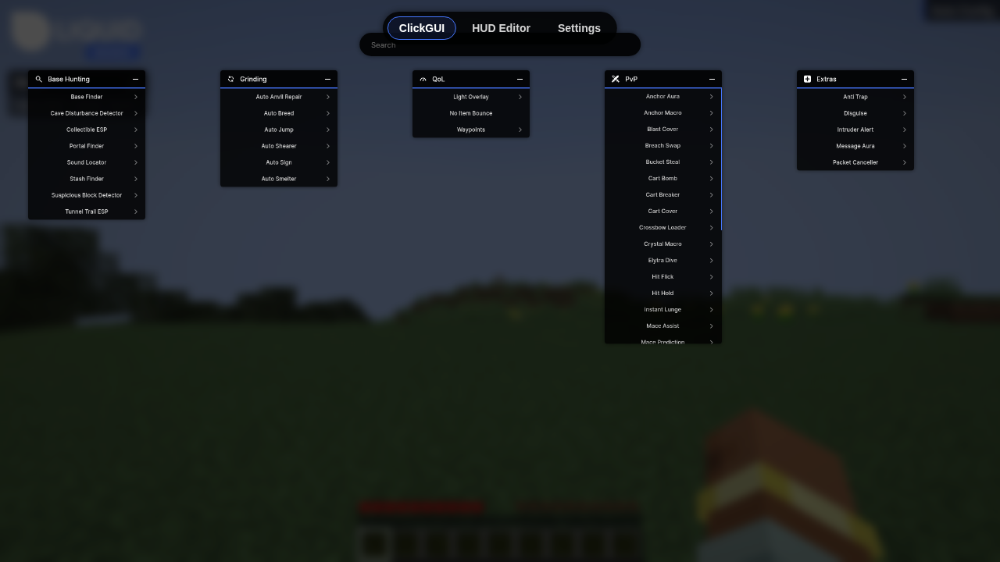

## Modules

### Base Hunting

- **BaseFinder** (Kotlin) reports chunks with blocks only players place, a pile of workstations, placed
  entities such as filled item frames, armor stands and boats, written signs, or villagers that have traded.
- **StashFinder** (Kotlin) reports chunks with many containers, counted by block, and follows them as they
  change. Trial chambers are left out.
- **SuspiciousBlockDetector** (Kotlin) reports doors, trapdoors, chests, ladders, beds, obsidian and metal
  blocks that appear near you once the chunks around you have settled.
- **CollectibleESP** (Kotlin) highlights valuables in item frames, filled maps included, and banners.
- **PortalFinder** (Kotlin) reports and marks lit Nether and End portals.
- **CaveDisturbanceDetector** (Kotlin) marks plain air in cave walls, where someone mined into a cave.
- **TunnelTrailESP** (Kotlin) highlights dug tunnels, staircases and one-wide shafts.
- **SoundLocator** (Kotlin) marks where the server played explosions, containers and portals, or whichever
  sounds you pick.

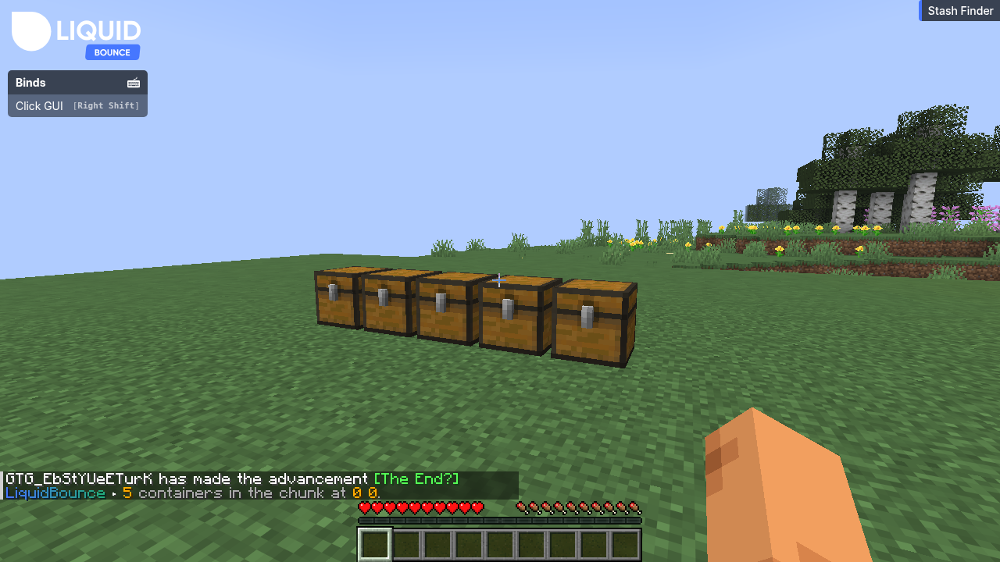
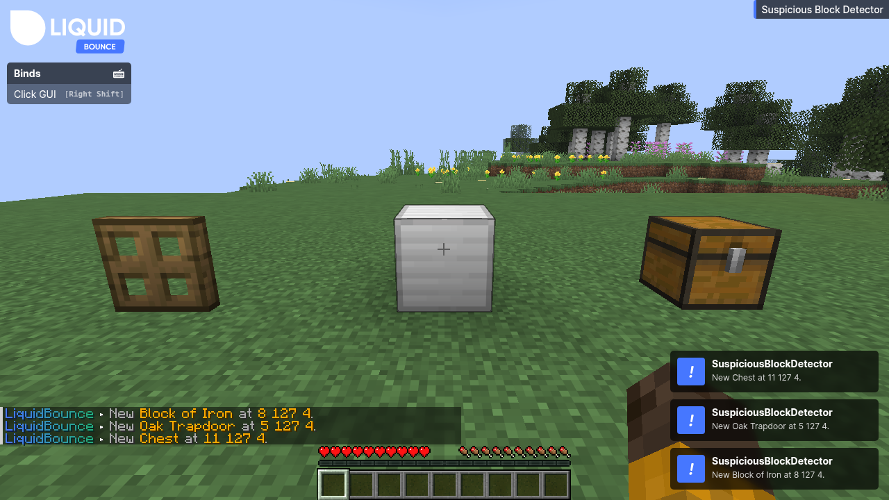

### Grinding

- **AutoJump** (Java) jumps for you: always, while moving, or while sprinting.
- **AutoShearer** (Kotlin) shears sheep in reach, switching to shears without changing your visible slot.
- **AutoSign** (Java) writes every new sign with the text of the last sign you wrote, or with a template for
  each side. The editor never opens. `Nearby` opens the blank signs around you for it, with an empty hand.
- **AutoAnvilRepair** (Kotlin) combines damaged items of the same kind in an open anvil, up to a level cost.
  Enchanted items are never sacrificed.
- **AutoSmelter** (Kotlin) keeps an open furnace, blast furnace or smoker going: takes out what is done, loads
  allowed ingredients and puts in a little fuel once the fire is out.
- **AutoBreed** (Kotlin) feeds adult animals in reach that have a partner nearby. Once the server shows hearts,
  it leaves them alone until they can breed again.
- **OreSimulation** (Kotlin) predicts the ores of the loaded chunks from the world seed by running the game's
  own ore placement, and outlines the ones you pick until they are mined or something you can see through
  takes their place.

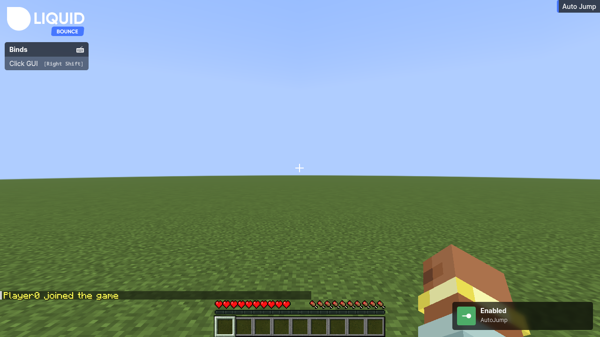
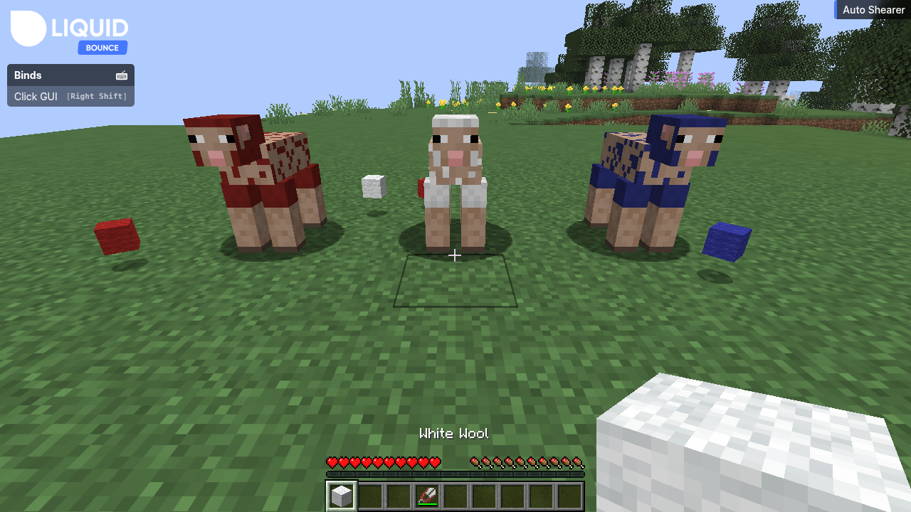
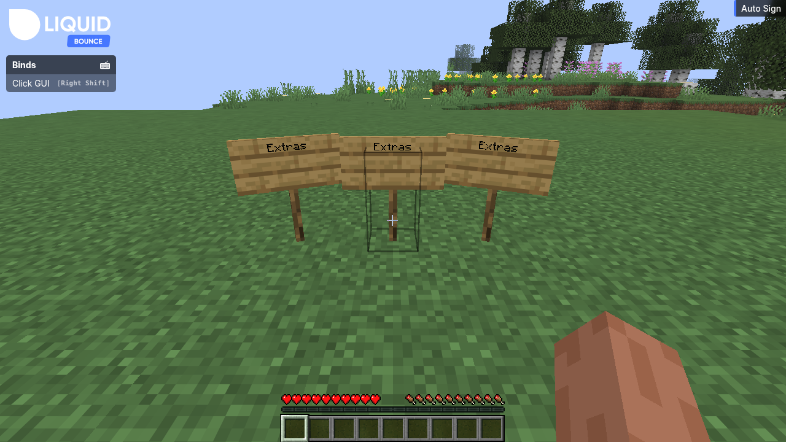
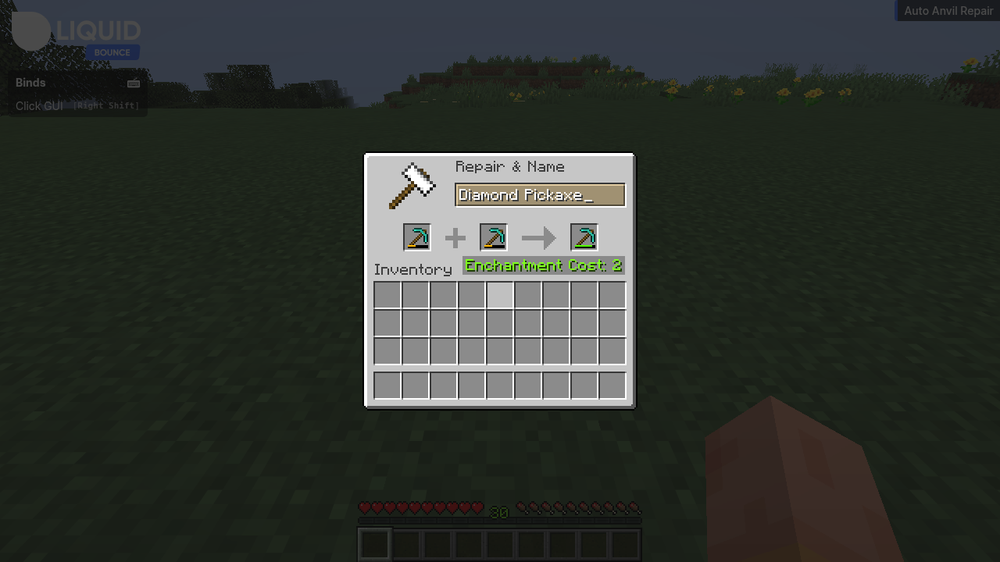
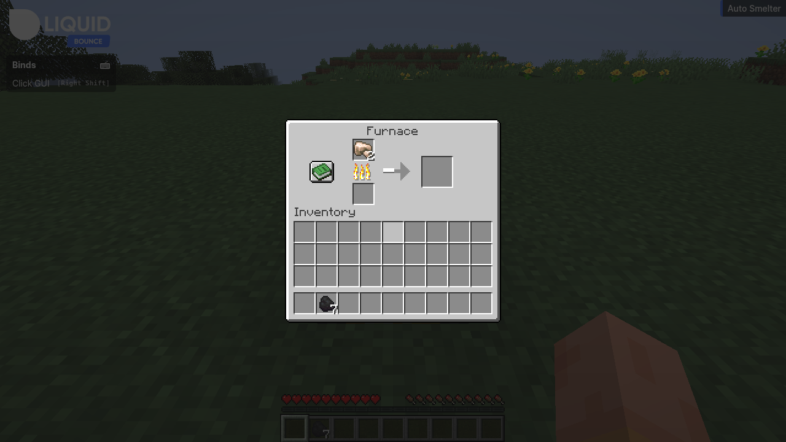
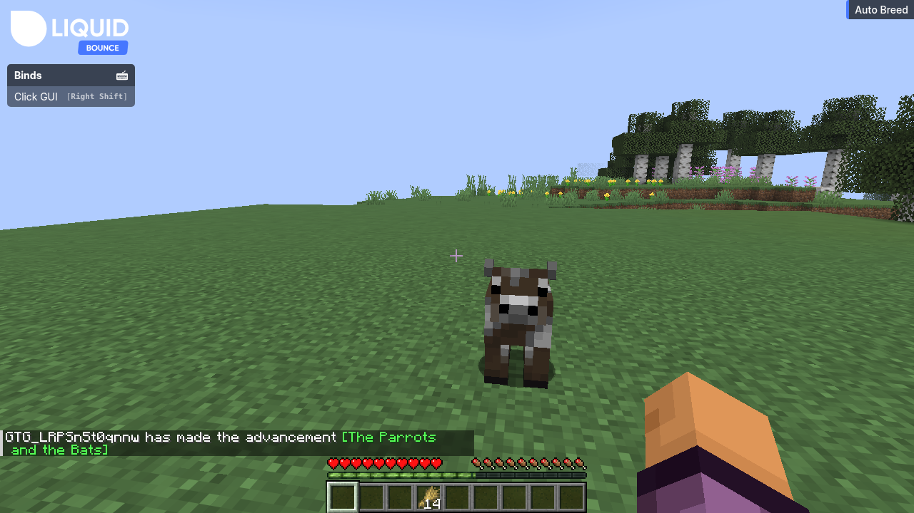


### QoL

- **LightOverlay** (Kotlin) marks where hostile mobs can spawn: red right now, yellow once it is dark.
- **Waypoints** (Kotlin) lists the waypoints of this world and dimension with distance and direction, and marks
  the selected one. They are saved per server or singleplayer world.
- **NoItemBounce** (Kotlin) stops hotbar items from bouncing when they change.

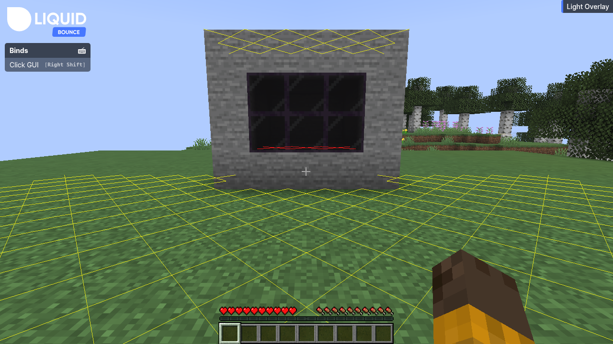
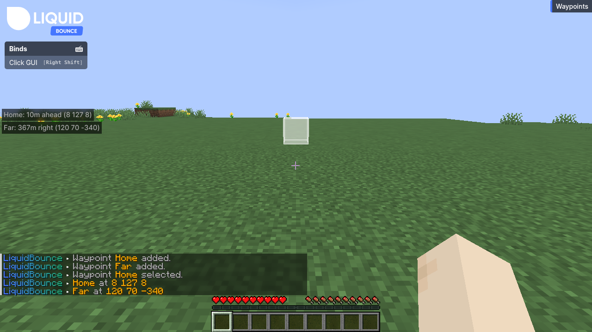

### PvP

- **AnchorAura** (Kotlin) places, covers, charges and sets off respawn anchors next to targets, within minimum
  target damage, maximum self damage and never-lethal limits. It also waits charged where an enemy's ender pearl
  lands, showing the landing spot and flight time. With OnlyExisting it only charges and sets off anchors already
  standing, and every stage has its own random delay.
- **AnchorMacro** (Kotlin) places an anchor where you look while its bind is held, then charges it and sets it
  off, with a silent or visible slot switch. It can set off only your own anchors and put a second anchor in the
  same spot, timed to the target's hurt time.
- **BlastCover** (Kotlin) puts obsidian or glowstone between you and a charged respawn anchor before it goes off,
  by a silent rotation or only on your crosshair, and holds the detonation until the cover is up. It can cover
  before charging already, skip blasts outside a damage window and cap the covers per anchor.
- **CrystalMacro** (Kotlin) places obsidian where you look if needed, then a crystal, and breaks it once, twice or
  until it is gone. It can follow your sword hits, time hits to the target's hurt time, skip while airborne, and
  leave a dead enemy's loot alone.
- **TotemSwitch** (Kotlin) puts a hotbar totem in your hand while the next hit could kill you: crystals, charged
  anchors, spots an enemy could crystal, a falling mace, a sword at low health, or optionally your own ender
  pearl in flight. It gives your slot back once you are safe.
- **MisplayGuard** (Kotlin) cancels your own losing clicks: glowstone into a charged anchor or onto anything else,
  opening an ender chest with combat items in hand, fireworks from the ground without a crossbow in the offhand,
  and sword hits on a raised shield.
- **BucketSteal** (Kotlin) scoops water and lava next to your enemy with an empty bucket, or plugs it with a
  cobweb, either on your crosshair only or aiming on its own, optionally only sources next to a cobweb.
- **CartBomb** (Kotlin) lays a rail with stacked TNT minecarts where you look, or where your own bow or crossbow
  shot is predicted to land. It sets them off with a Flame bow, or with a shot through fire it lights first, can
  put a safe block at your feet, and switches back to your bow. While you draw a bow it can shoot a cart already
  lying next to an enemy, and an Overload key stacks several carts in one go.
- **PearlCart** (Kotlin) lays a TNT minecart next to where an enemy's ender pearl comes down and shoots it as they
  arrive, if the blast would hurt them enough and you little enough.
- **CartBreaker** (Kotlin) hits unlit TNT minecarts others put down within reach and view, with a sword and a
  reaction delay, and leaves your own alone.
- **CartCover** (Kotlin) places blocks between you and a lit TNT minecart until the predicted damage is low enough,
  against your own carts, others' or both, with a cap on blocks per cart.
- **SwingRedirect** (Kotlin) turns a swing at the air onto the closest target near the crosshair, through one tick
  of silent rotation towards a chosen body height, or by keeping the silent rotation on it all along, with an
  optional dot at the aim point.
- **HitHold** (Kotlin) holds a swing at a target that is still hurt or in the air and lands it through a silent
  rotation as soon as it can, giving up after a second.
- **HitFlick** (Kotlin) turns the server-side rotation sideways by a random angle for one tick before each hit,
  left, right or either way, then snaps back with a little jitter and hits; optionally only players or sprint hits.
- **CrossbowLoader** (Kotlin) takes a crossbow from the hotbar or inventory, holds use until it is loaded, goes
  back to the slot in hand and switches itself off, or keeps the crossbow in hand until you fire it.
- **ShieldSwap** (Kotlin) blocks with a shield from the hotbar or inventory: a shield on one press and the weapon
  on the next, or a shield while the key is held.
- **ShieldGuard** (Kotlin) raises a shield when a close enemy can swing again or runs at you, lowers it while you
  fall onto a target for a critical hit or glide, and holds a sword while the shield is disabled. It can skip
  enemies without a weapon, keep the shield down against axes and block on the way up of a jump; no attacks go
  out while it blocks.
- **MaceAssist** (Kotlin) holds the best mace while you fall onto an enemy, Breach for short falls and Density for
  long ones, can swing it for you, hits a raised shield with an axe first (always, by chance or on a key) and swaps
  an elytra for a chestplate before the impact.
- **BreachSwap** (Kotlin) now and then swings your Breach mace instead of your sword for one hit; the sword is back
  with the next tick.
- **ElytraDive** (Kotlin) takes off with your elytra once you stand on the ground, boosts with a rocket and puts
  the chestplate back after a set time, taking any of them from the inventory if the hotbar has none. ReDive
  climbs above the enemy after a mace hit and dives onto it again.
- **ShieldDrain** (Kotlin) hits an enemy who holds up a shield several times a tick, with a mace from the hotbar
  if you have one, optionally only while you fall.
- **SpearAssist** (Kotlin) stabs with a spear what your sword, axe or mace cannot reach, follows a spear charge
  hit during a fall with a mace hit, and shows the damage your charge would deal.
- **InstantLunge** (Kotlin) lunges once with your best Lunge spear, puts your slot back after a short random delay
  and turns itself off.
- **MacePrediction** (Kotlin) shows where the nearest enemy in the air comes down, or where a walking one goes up to
  the next edge, with your reach around it.
- **PearlLaunch** (Kotlin) throws an ender pearl where you look and, the moment the server lands you, a wind
  charge at your feet with an optional jump.
- **WindGlide** (Kotlin) equips and opens an elytra, then throws wind charges steeply down whenever the ground
  gets close (closer the faster you fly), and stops once you wear a chestplate again.
- **PearlHop** (Kotlin) throws a pearl at your feet for a short hop, once or whenever a player hits you (or
  anything, if you like).
- **PearlCatch** (Kotlin) throws a pearl, then a wind charge at your feet that launches you into the pearl's path,
  so it catches you mid-air: straight up, along your view with the throw timed by simulating you, the pearl and
  the charge, or both back to back from the offhand.

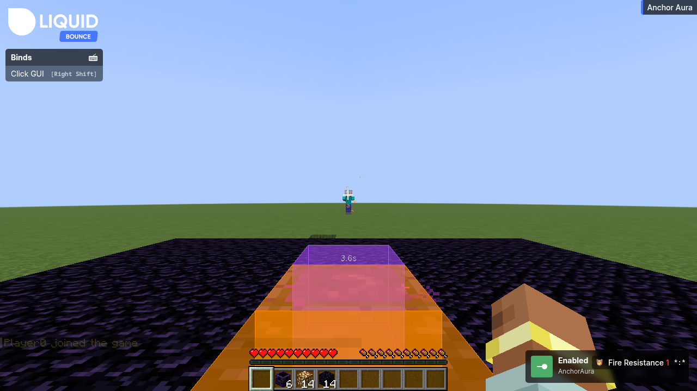
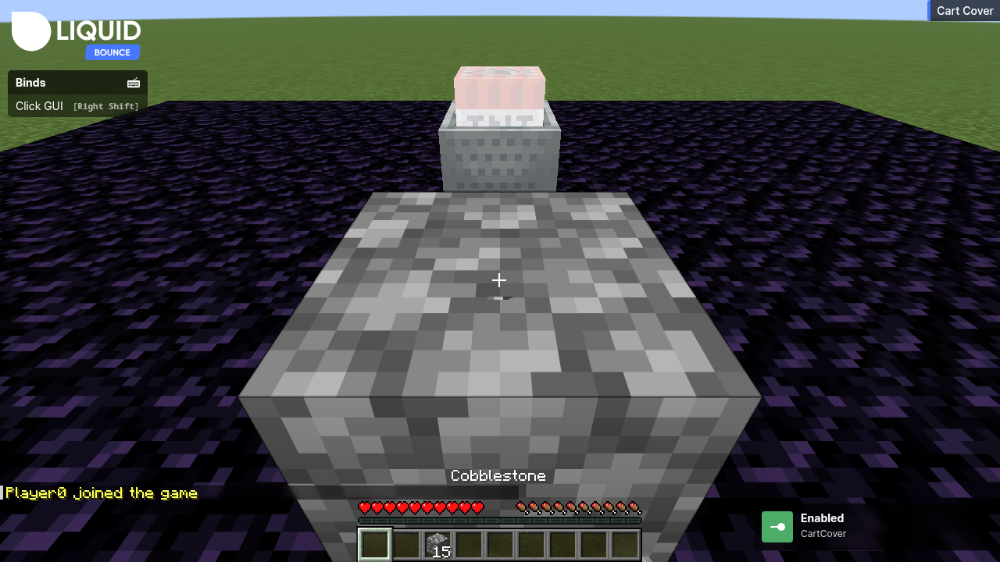
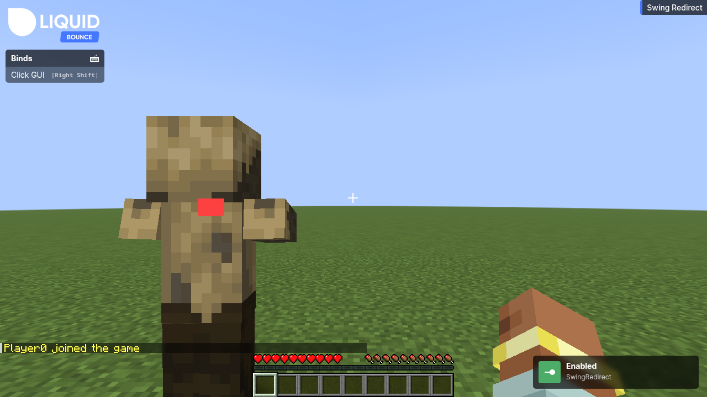

### Extras

- **MessageAura** (Java) whispers a message to every player who comes into view, one per delay.
- **PacketCanceller** (Kotlin) drops the packets you pick, in either direction.
- **IntruderAlert** (Kotlin) reports players who are not your friends as they come near.
- **AntiTrap** (Kotlin) keeps armor stands, minecarts, item frames, boats and end crystals near you out of your
  world, each on its own toggle, and refuses sign editors the server opens without you placing or clicking that
  sign, including one already open when you turn it on.
- **Disguise** (Kotlin) shows the nearest player who is not your friend under another name with a rank tag,
  wherever text is drawn, wearing the skin of a Mojang account you pick. Their nametag can carry a tier and
  the icon of a kit in front.

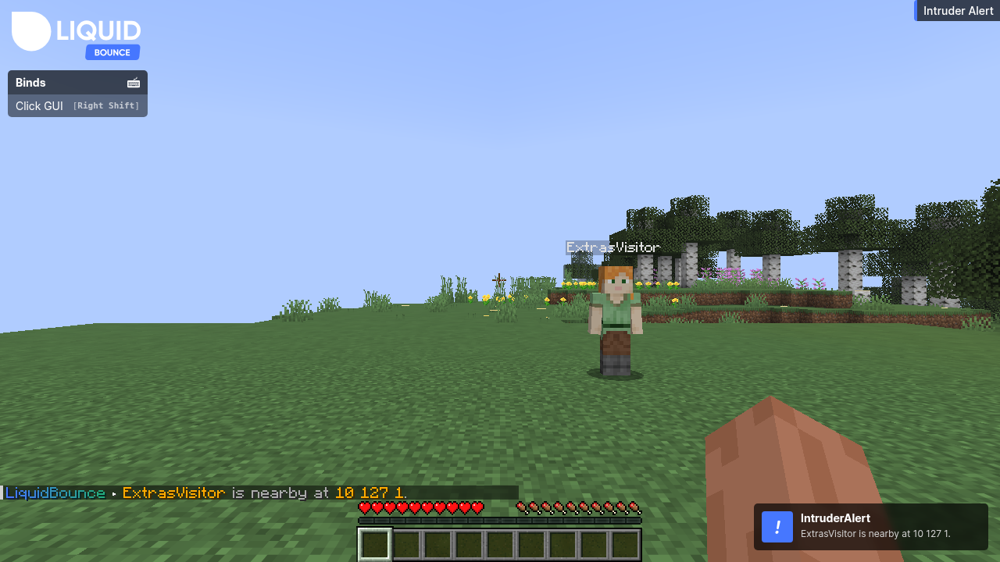
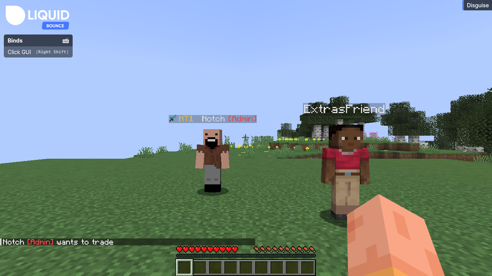

## HUD components

Add **FPS**, **TPS**, **Ping**, **Player**, **CPS**, **Biome**, **Coordinates**, **Speedometer** or **Clock** in
the HUD editor. Each has its own prefix, suffix, colour, shadow, padding and background. **FPS**, **TPS** and
**Ping** colour their value good, ok or bad and draw a graph of the last twelve seconds under it; TPS drops to 0
once the server has not sent the time for three seconds. **Clock** can blink its colon and show how far the minute
has run. **CartKit** shows rails, TNT minecarts, a bow or loaded crossbow, its draw and the live carts nearby.

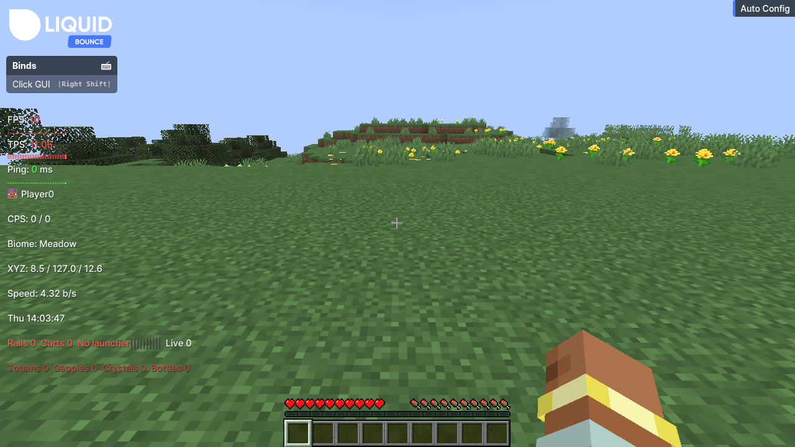
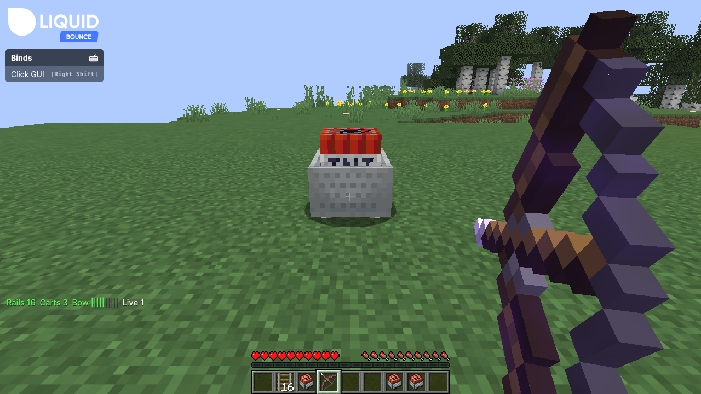

## Commands

`.where` prints your position, `.where share` says it in the server chat. `.waypoint add <name> [x y z]`,
`.waypoint remove <name>` and `.waypoint list` manage the waypoints, `.waypoint select <name>` and
`.waypoint deselect` the mark.

`.findings list`, `.findings show <id>` and `.findings forget <id>` manage what BaseFinder and StashFinder
found, `.findings waypoint <id> <name>` turns a finding into a waypoint. Waypoints and findings are saved in
`LiquidBounce/extras-worlds/`.

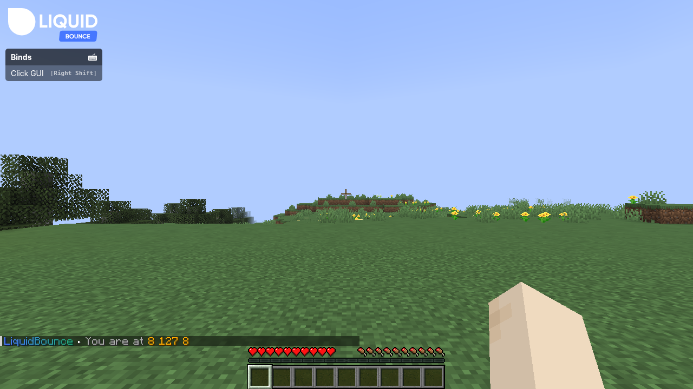

## Building and testing

```sh
./gradlew build
./gradlew runClientGameTest
```

Every game test boots its own Paper 26.3 server with the newest [Grim](https://modrinth.com/plugin/grimac) and
fails when the server objects to anything the client did. [AGENTS.md](AGENTS.md) explains how.

## Commits

`type(scope): subject`, lowercase, no trailing period.

`feat` `fix` `refactor` `chore` `docs`

Scope is the component it lands in: `AutoSign`, `hud`, `gametest`. Drop it when the change spans the
repository. Add a body when the subject alone leaves the next reader guessing.

## Contributing

We appreciate contributions. So if you want to support us, feel free to make changes to LiquidBounce's source code and
submit a pull request.

## Credits

| File | Section | Taken from | Taken as |
|---|---|---|---|
| `modules/qol/ModuleLightOverlay.kt` | Spawn rule | [Meteor Client `BlockUtils`](https://github.com/MeteorDevelopment/meteor-client/blob/79a30a7c9ad459b9cfc1155c598aa58947db7fa5/src/main/java/meteordevelopment/meteorclient/utils/world/BlockUtils.java#L313-L338) | Derived code, GPL-3.0 |
| `modules/basehunting/ModuleStashFinder.kt` | Trial chamber filter | [Meteor Client `StashFinder`](https://github.com/MeteorDevelopment/meteor-client/blob/79a30a7c9ad459b9cfc1155c598aa58947db7fa5/src/main/java/meteordevelopment/meteorclient/systems/modules/world/StashFinder.java#L64-L73) | Idea and block list, GPL-3.0 |
| `modules/basehunting/ModuleCaveDisturbanceDetector.kt` | Plain air next to cave air | [Trouser-Streak `CaveDisturbanceDetector`](https://github.com/etianl/Trouser-Streak/blob/0cf3231b56c25773cd66aa21931470bdf8799c9e/src/main/java/pwn/noobs/trouserstreak/modules/CaveDisturbanceDetector.java) | Idea |
| `modules/basehunting/ModuleBaseFinder.kt` | Written signs and traded villagers | [Trouser-Streak `BaseFinder`](https://github.com/etianl/Trouser-Streak/blob/be39bf88955d91261471a3462af4ef8a5f18b9f4/src/main/java/pwn/noobs/trouserstreak/modules/BaseFinder.java) | Ideas |

## License

This project is subject to the [GNU General Public License v3.0](https://www.gnu.org/licenses/gpl-3.0.en.html). This
does only apply for source code located directly in this clean repository. During the development and compilation
process, additional source code may be used to which we have obtained no rights. Such code is not covered by the GPL
license.

For those who are unfamiliar with the license, here is a summary of its main points. This is by no means legal advice
nor legally binding.

*Actions that you are allowed to do:*

- Use
- Share
- Modify

*If you do decide to use ANY code from the source:*

- **You must disclose the source code of your modified work and the source code you took from this project. This means
  you are not allowed to use code from this project (even partially) in a closed-source (or even obfuscated)
  application.**
- **Your modified application must also be licensed under the GPL**
